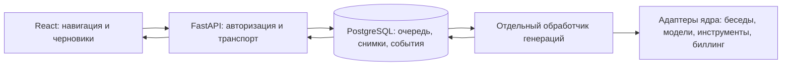

# Архитектурное обновление BitThink — 25 октября 2026

## Выполненные изменения

Сохранён текущий стек React / FastAPI / PostgreSQL. Генерация ответов отделена
от веб-сервера, состояние вынесено в БД, определены границы серверных доменов,
разделены основные обязанности экрана чата и добавлена диагностика браузера.

### Выполнение ответов

- Запрос сохраняется до подтверждения приёма. Блокировка аккаунта и уникальный
  ключ активной задачи защищают от параллельного запуска в одной беседе.
- Модель и уровень размышления фиксируются при отправке. Последующая смена
  режима не меняет уже поставленный в очередь запрос.
- Отдельный процесс выполняет обычные ответы и обслуживает существующие
  фоновые задачи Оркестратора. Перезапуск веб-сервера не останавливает этот процесс.
- Снимок ответа и событие записываются одной транзакцией. Подписка получает
  снимок и курсор из одного представления БД: переподключение не дублирует текст.
- Отмена проверяется обработчиком; отменённая до исполнения задача не вызывает модель.
- У работающей задачи есть владелец и срок аренды. После аварии обработчика
  сохраняются частичный результат и статус прерывания. Автоматического повторения
  потенциально уже выполненных внешних действий нет. Продолжение требует явного
  действия пользователя; бесшовное продолжение произвольного внешнего инструмента
  после аварии не обещается.
- Журнал событий очищается через 15 минут, завершённые записи задач — через сутки.
  Тело запроса удаляется из очереди при завершении. Долгосрочная история бесед остаётся
  в существующих таблицах.
- Обработчик имеет отдельные ограничения ресурсов: по умолчанию 2 ГиБ памяти,
  2 CPU и 256 процессов. Значения задаются через GENERATION_WORKER_MEMORY/CPUS.

### Интерфейс и состояние

- Навигация и выбор беседы выделены в `useConversationNavigation`.
- События, отмена и восстановление генераций — в `useChatGeneration`.
- Сборка сохранённой истории и текущего ответа — в чистую функцию `projectConversation`.
- Обработанные кадры WebSocket подтверждаются и удаляются из очереди интерфейса.
  Они больше не накапливаются за всё время сессии и не просматриваются повторно
  при каждом новом фрагменте; фиксированного буфера, отбрасывающего всплеск кадров, нет.
- Основной файл ChatPage сокращён с 1668 до 1283 строк. Отдельные компоненты
  проектов и документов сохранены; полная перепись интерфейса не проводилась.
- Статус прерванной задачи восстанавливается после открытия вкладки и отображается
  один раз. История и черновик остаются доступны.

### Серверные границы и согласованность

- Веб-API и сервисы больше не обращаются к `repo._manager`.
  Выделены именованные адаптеры бесед, общего доступа, заметок, авторов, шаблонов
  и биллинга. Совместимость с прежним ядром сохранена внутри `app/core`.
- Денежные правила не дублируются: адаптер биллинга использует прежний механизм
  блокировки и транзакций. Каталог тарифов, коэффициенты и лимиты моделей сохранены.
- На PostgreSQL выбор и создание беседы защищены транзакционной блокировкой
  аккаунта. Устранена гонка, оставлявшая две активные беседы.
- Чтение и запись явно указанной истории не переключают текущую беседу. Ответ,
  выполняющийся в фоне, не владеет состоянием навигации.
- Шаблоны документов и активная пользовательская инструкция читаются из БД,
  поэтому другой процесс видит их обновление и удаление.

### Миграции, диагностика и публикация

- Запуск приложения проверяет схему, но не создаёт и не изменяет таблицы.
  Alembic запускается отдельным шагом выкладки.
- Начальная миграция больше не импортирует текущую ORM-схему: исправлено
  повторное добавление столбцов при создании базы с нуля. Схемы миграций
  001, 019, 020, 021 зафиксированы; новый шаг 022 добавляет очередь и события.
- Диагностика браузера отправляет только категорию ошибки, нормализованный маршрут,
  имя сборки, имена JS-файлов и координаты кадров. Текст ошибки, сообщения пользователя,
  токены, параметры URL и ссылки-приглашения не передаются. Требуется авторизация;
  количество отчётов ограничено и на клиенте, и на сервере.
- `/health` проверяет доступность API, `/ready` — также актуальное присутствие обработчика.
- Прокси обновляет адрес API при пересоздании контейнера. Проверена конфигурация
  установленного Nginx 1.31.2 и смена адреса без перезапуска прокси.
- Образ собирается из полного согласованного набора исходников. Проверяются
  контрольные суммы, подготовлен возврат к предыдущему образу и сохранена резервная копия БД.
- В GitHub Actions добавлены миграции на чистой PostgreSQL, проверка всей ORM-схемы
  до запуска тестовых фикстур, контроль границ доменов, серверные тесты и проверки интерфейса.

## Полученные результаты

- Производственная сборка и TypeScript — успешно.
- Полный серверный набор на PostgreSQL в изолированном контейнере: **935 проверок**.
- Полный набор интерфейса в Chrome: **101 проверка**, неожиданных исключений нет.
- Миграции прошли на новой SQLite, новой PostgreSQL и копии рабочей PostgreSQL.
- В копии рабочей базы сохранены **6830 записей в 28 прежних таблицах**;
  схема после миграции соответствует всем **31 ORM-таблице**.
- В процессном тесте настоящий API был удалён и создан с другим адресом,
  пока отдельный обработчик готовил ответ. Ответ сохранён, модель-фикстура вызвана один раз,
  старые фрагменты при переподключении не повторились. Прокси не перезапускался.
- При принудительном завершении обработчика сохранены частичный ответ и статус
  прерывания; автоматического повторного вызова фикстуры не произошло.
- Обновление опубликовано на `https://bit-think.space/`: API и отдельный
  обработчик имеют статус healthy, схема — 022, `/api/ready` отвечает успешно.
- На опубликованной сборке прошли **13 проверок переходов** в Chrome.
- Через публичный защищённый WebSocket выполнен настоящий запрос к GPT-6 Luna:
  ответ «138» получен за 3,96 секунды и сохранён в истории. Временный тестовый
  аккаунт и его беседа удалены после проверки.
- После выкладки в журналах API и обработчика нет ошибок и аварийных перезапусков;
  настройки окружения и остальные контейнеры сохранены. Перед выкладкой
  создана свежая резервная копия рабочей БД.

Процессные проверки используют изолированную БД и тестовый обработчик вместо
платного провайдера. Проверки интерфейса используют управляемые ответы API.
Проверены размеры 320, 390 и 1440 пикселей, светлая и тёмная темы; физический
телефон и большая эксплуатационная нагрузка в эти проверки не входят.

## Порядок следующих выкладок

1. Собрать полный образ из проверенного коммита; выполнить проверки CI.
2. Сохранить резервную копию БД и предыдущий образ. Проверить активные запросы
   перед остановкой старого процесса; не прерывать незавершённые внешние действия.
3. Запустить `alembic upgrade head` отдельным одноразовым контейнером.
4. Обновить API и обработчик. Дождаться успешного `/api/ready`.
5. Опубликовать хешированные файлы интерфейса, затем заменить index.html.
   Предыдущие хешированные файлы сохранять для уже открытых вкладок.
6. Запустить `python scripts/verify_release.py` и проверить реальную генерацию.

При возврате к старому образу после добавочной миграции 022 таблицы очереди
не удалять. Если старый образ не знает ревизию 022, запускать его напрямую
через Uvicorn без встроенного `alembic upgrade head`. Историю БД не откатывать
из резервной копии поверх новых пользовательских записей.

Принцип динамического адреса upstream подтверждён в
[документации Nginx](https://nginx.org/en/docs/http/ngx_http_upstream_module.html#server).
